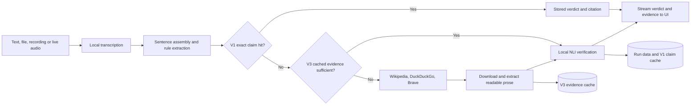

# Live Video Transcription and Fact Checking

A HES-SO 301/302 hackathon project: a local web app that transcribes speech, picks out factual claims and checks them against evidence from the web, all with models running on a laptop.

You give it text, an audio/video file or a microphone recording, or let it listen live to the computer's audio. The transcript streams into the page segment by segment, and each claim is marked as it is checked:

| State | Meaning |
| --- | --- |
| Not checked | Not a checkable claim, or retrieval found no usable evidence |
| Checking | Search or verification in progress |
| Supported | A retrieved passage entails the claim |
| Contradicted | A retrieved passage contradicts the claim |
| Uncertain | Evidence was found, but it was weak or conflicting |

Selecting a claim shows the explanation, the evidence passages with their source URLs, the NLI scores and per-stage timings. The research question is how far verification latency can be reduced (caching, parallelism, smaller models) without losing quality, so the dashboard also reports p50/p95 latency and cache hit rate.

The backend implements four pipeline versions, selectable in the UI:

| Version | ID | What it adds |
| --- | --- | --- |
| V0 | `baseline` | Rule-based claim extraction, web search, NLI verification, sequential |
| V1 | `claim-cache` | Exact-match cache of verified claims (1 h TTL, max 1000 entries) |
| V3 | `two-caches` | V1 plus a full-text cache of evidence passages from downloaded pages |
| V4 | `parallel` | V1 with an adjustable pool of 1–8 claim-checking workers, capped by the detected CPU count (default 3 where available) |

V2 (`two-ai`, model-based atomic-claim extraction) is planned and shown as unavailable. V4 is deliberately a prototype using V1's current components, so its measurements isolate the effect of concurrency rather than combining several unfinished changes.

## How V3 works

V1 and V3 avoid different work:

| Cache | Stores | Work avoided on a hit |
| --- | --- | --- |
| V1 verified-claim cache | An exact normalised claim, its supported/contradicted verdict, scores, explanation and cited page passage | Search, page download and NLI verification |
| V3 evidence cache | Readable prose sentences from pages previously downloaded during verification | Web search and page download; the cached passages are still scored by NLI for the new claim |

For a V3 claim, the pipeline first checks the V1 claim cache. On a V1 miss, it searches `v3_evidence_cache.db` through SQLite FTS5 using the claim's content words. Candidates must share at least half of those words. If at least two relevant cached passages produce a clear supported or contradicted NLI verdict, the result uses the `evidence_cache` path and skips the web. Otherwise, Wikipedia, DuckDuckGo and Brave are queried concurrently and their results are selected in that fixed order; readable sentences from successfully downloaded pages are then saved for later claims.

The evidence cache expires pages after 24 hours, keeps at most 500 pages and stores at most 2,000 prose sentences per page. It is a retrieval optimisation, not a reused truth verdict: related cached text is always assessed against the current claim.

## Architecture



## Repository layout

```
HES-Hackathon/
├── webapp/
│   ├── backend/
│   │   ├── main.py               # FastAPI routes; also serves the frontend
│   │   ├── api_helpers.py        # version check, streamed NDJSON responses
│   │   ├── schemas.py            # request/response models (frontend contract)
│   │   ├── versions.py           # pipeline versions and the steps each enables
│   │   ├── pipeline.py           # runs the services for one request
│   │   └── services/
│   │       ├── transcription.py  # Whisper files/recordings; Kroko live capture
│   │       ├── extraction.py     # sentence assembly and checkability rules
│   │       ├── verification.py   # web search, passage extraction, NLI verdict
│   │       └── storage.py        # SQLite schema, run data and both caches
│   └── frontend/                 # experiment dashboard and simplified live view
│                                 # README.md describes the API contract
├── database/                     # created on startup, not tracked
│   ├── app.db                    # run data: sources, segments, claims, verdicts
│   ├── v1_claim_cache.db         # V1 verified-claim cache
│   └── v3_evidence_cache.db      # V3 page-sentence cache and FTS5 index
├── asr/                          # speech-recognition experiments (notebooks)
├── benchmarks/                   # saved V1 benchmark results (JSON)
├── samples/                      # test audio and its reference transcript
├── ai_agent.ipynb                # V0 verifier prototype
├── ai_agent_v1.ipynb             # V1 claim-cache prototype
├── claim_extraction.ipynb        # LLM claim-extraction experiment (Qwen2.5)
├── database.ipynb                # database schema design
├── pipeline_v0.ipynb             # end-to-end V0 pipeline prototype
├── audio_capture.py              # loopback/microphone capture test
├── live_transcribe.py            # live transcription with faster-whisper
├── live_transcribe_kroko.py      # live transcription with sherpa-onnx
├── pyproject.toml                # dependencies
└── uv.lock                       # locked environment
```

The services don't depend on HTTP, so the notebooks can import them for benchmarks.

## How to run

Requirements: Python 3.12 and [uv](https://docs.astral.sh/uv/). Internet access is needed for web search and, on the first run, to download the models.

From the repository root:

```bash
uv sync
uv run fastapi dev webapp/backend/main.py
```

Wait for `Application startup complete` (Whisper and the NLI model load first), then open <http://localhost:8000/>. The API docs are at <http://localhost:8000/docs>.

- The status dot in the top bar is grey while the backend is loading or down, green when the selected version is implemented, and amber when it isn't.
- `fastapi dev` reloads on backend changes. After editing the frontend, refresh the page (Ctrl+F5 if the browser caches `app.js`).
- Don't open `webapp/frontend/index.html` directly or serve it with `python -m http.server`: the page then has no API and shows the backend as disconnected.
- Run `uv sync` again after pulling changes.
- **Clear caches** in the dashboard asks for confirmation, then empties both `v1_claim_cache.db` and `v3_evidence_cache.db`. Transcript and run history in `app.db` are kept.
- **Open the live view** uses Kroko to transcribe computer audio while it plays. Windows uses WASAPI loopback. On macOS, BlackHole provides loopback; without it, the backend falls back to the microphone and warns the user.

For the notebooks, select `.venv` as the kernel and run them from the repository root.

## Dependencies
### Models

All inference runs locally on the CPU. Models are downloaded from Hugging Face on first use.

| Use | Model | Where |
| --- | --- | --- |
| Files and browser recordings | Whisper `small` via [faster-whisper](https://github.com/SYSTRAN/faster-whisper), int8, English | `services/transcription.py` |
| Live computer audio / microphone | Kroko streaming Zipformer via `sherpa-onnx`, English | `services/transcription.py` |
| Claim verification (NLI) | [`cross-encoder/nli-MiniLM2-L6-H768`](https://huggingface.co/cross-encoder/nli-MiniLM2-L6-H768) | `services/verification.py` |
| Claim extraction (experiment only) | Qwen2.5 0.5B / 1.5B Instruct | `claim_extraction.ipynb` |
| ASR comparisons (experiments only) | Whisper large-v3-turbo and other ASR configurations | `asr/` |

Claim extraction in the web app is rule-based (`services/extraction.py`), using pySBD for sentence splitting.

### Retrieval

Wikipedia's API and the DuckDuckGo/Brave backends provided by [ddgs](https://pypi.org/project/ddgs/) are queried concurrently, then their answers are selected in that fixed priority order. No API keys are needed. Result pages are downloaded and reduced to readable prose with [trafilatura](https://trafilatura.readthedocs.io/); a verdict needs at least one passage taken from a page, never just a search snippet.

### Databases

SQLite, created automatically in `database/` (WAL mode, foreign keys on). The files use the schema and cache migrations in `services/storage.py`:

| File | Contents |
| --- | --- |
| `app.db` | `sources`, `transcript_segments`, `claims`, `claim_segments`, plus each verdict with its evidence (`verified_claims`, `evidence`, `verdict_evidence`) |
| `v1_claim_cache.db` | V1 cache: reusable `verified_claims` with their cited `evidence`. Entries are keyed by normalised claim text and verifier version, so changing the model or rules invalidates them |
| `v3_evidence_cache.db` | V3 cache: page prose in `evidence`, indexed by the SQLite FTS5 `evidence_fts` table and isolated by cache version |

### Python packages

Declared in `pyproject.toml`, locked in `uv.lock`. The main ones:

- **Web:** `fastapi[standard]`
- **Speech:** `faster-whisper`, `av` (audio decoding), `soundcard` / `sounddevice` (live capture), `sherpa-onnx`
- **NLP:** `torch`, `transformers`, `pysbd`
- **Retrieval:** `ddgs`, `trafilatura`
- **Storage:** `sqlite-vec` (for the planned embedding search)
- **Evaluation:** `jiwer` (word error rate), `datasets`

Intel Macs get pinned older versions of `torch`, `transformers`, `numpy` and `onnxruntime`, and Whisper runs in a separate process there to avoid an OpenMP library conflict.

## Evaluation status

The dashboard reports running p50/p95 claim latency, claim-cache hits, evidence-cache hits and queue depth. Completed real runs can be exported as JSON for controlled comparison; interface-demo fixtures are labelled illustrative and are never included.

The JSON files in `benchmarks/` preserve earlier V1 development runs. They predate the current Wikipedia API retrieval, V3 evidence cache and V4 live pipeline, and some contain documented search failures. They are historical evidence, not final comparative results. A final V0/V1/V3/V4 benchmark should replay identical inputs and report fresh retrieval, cold/warm cache state, verdict quality, retrieval-failure rate, p50/p95 latency and worker count separately.

## Current limitations

- English only.
- The web app treats each checkable sentence as a claim; model-based atomic-claim extraction and reference resolution remain V2 work.
- Fresh checks depend on live search providers and readable third-party pages, so results and latency can vary between runs.
- The NLI score is uncalibrated and is not a probability that a claim is true. The interface exposes the source passage so the user can inspect it.
- V1 uses deliberately conservative exact whitespace-normalised matching; paraphrases are misses.
- V3 uses lexical full-text retrieval rather than embeddings and accepts cached evidence only when it produces a clear NLI verdict.
- V4 bounds claim-level concurrency, but each fresh claim queries several providers, local NLI inference is serialized, and network retrieval usually remains the dominant cost.
- Computer-audio loopback is platform dependent: native WASAPI on Windows and BlackHole on macOS; microphone fallback can reduce transcription quality.

## Team contributions

| Workstream | Responsibilities | Assignee |
| --- | --- | --- |
| Audio and transcription | Audio/video ingestion, live capture, local ASR, timestamps and transcription latency | Ünal |
| Storage and parallel processing | SQLite databases, both caches, indexing, bounded workers and retrieval measurements | Alexis |
| AI and verification | Claim detection experiments, retrieval, evidence assessment, NLI model selection and quality evaluation | Youssef |

The integrated web application, demonstration and final comparisons are shared responsibilities. For HES-SO 301, the project studies local AI-model and quality/latency trade-offs; for 302, it demonstrates streaming processing, persistent caches, indexing, provenance, concurrency and resource-aware execution.
