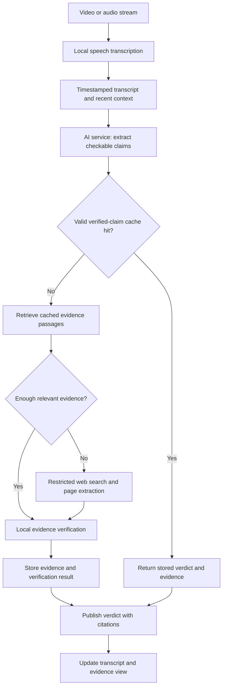

# Live Video Transcription and Fact Checking

A HES-SO 301/302 hackathon project investigating how quickly a lightweight local system can transcribe speech, identify factual claims, and check them against cited evidence.

The main research question is **how far we can reduce verification latency through model optimisation, restricted retrieval, caching, and parallel processing while preserving verification quality**. We aim for sub-second verification where feasible, particularly for claims whose verification results are already cached.

## Status

This repository currently documents the project plan. The features and architecture below describe intended behaviour, not completed functionality or measured performance. Model choices, installation instructions, and benchmarks will be added as implementation progresses.

## User experience

A user watches a video while its transcript appears underneath. The system checks factual claims asynchronously and highlights the relevant transcript passages. Selecting a checked passage reveals the claim, a short explanation, the evidence excerpt, and its source URL.

| State | Meaning |
| --- | --- |
| Not checked | Pending analysis, outside the supported scope, or not a checkable claim |
| Checking | Retrieval or verification is in progress |
| Supported | Retrieved evidence supports the claim |
| Contradicted | Retrieved evidence contradicts the claim |
| Uncertain | Evidence is insufficient, conflicting, or missing necessary context |

Missing evidence produces an uncertain result rather than a false verdict. The interface supports users in assessing a claim and inspecting its sources.

## Scope and constraints

- Run inference locally using pretrained models available through Hugging Face, without hosted model inference APIs.
- Start with one language and one supported video/audio input.
- Restrict web retrieval to a small, configurable source allowlist and a defined topic scope.
- Keep the application practical for the professor's laptop, with a bounded cache and modest model footprint.
- Store useful evidence passages rather than entire websites, large knowledge dumps, or permanent video recordings.
- Measure performance on documented hardware before claiming that a latency target has been achieved.

Exact models, sources, topic scope, and storage limits remain implementation decisions.

## Architecture

Transcription continues while verification runs. Claim IDs and video timestamps link each result to the correct transcript passage. Verification uses sufficiently stable transcript segments and recent context to resolve references, dates, numbers, and negation.

### AI service

One AI service owns checkability detection, claim extraction, embedding generation, and evidence assessment. It may contain several specialised local models behind one interface. The database does not need a separate NLP agent.

The service distinguishes opinions from checkable claims, requests evidence from the retrieval component, and returns structured verdicts with evidence references. Model scores must be evaluated before being presented as confidence estimates.

### Retrieval and caching

Two caches serve different purposes:

| Cache | Contents | Work it can avoid |
| --- | --- | --- |
| Verified-claim cache | Claim, verdict, evidence references, verification time, expiry, and model version | Repeating retrieval and verification for an equivalent, still-valid claim |
| Evidence cache / RAG index | Extracted passages, source URLs, dates, and embeddings | Repeating web searches, downloads, and passage processing |

Retrieval-augmented verification supplies source passages to the model. A related passage is a candidate source of evidence, not automatically a verdict.

Cache matching must preserve entities, negation, quantities, and temporal context. Semantic similarity finds candidate matches; additional checks determine whether their verdicts can be reused. Stable historical facts can have longer expiry periods than changing statistics or current officeholders.

The cache has a configurable size limit and eviction policy. Retrieval concurrency and queue growth are bounded to keep the laptop responsive.

## MVP and optimisation plan

1. **Functional baseline:** connect streaming transcription, claim extraction, retrieval, and cited verification. A terminal or structured event output is sufficient initially. Record latency without imposing a speed requirement.
2. **Minimal demonstration:** display the video/transcript and allow users to inspect evidence behind each verdict.
3. **Cache experiments:** compare fresh retrieval, cached evidence, and cached verified claims, including paraphrases and deliberately different claims.
4. **Inference optimisation:** benchmark smaller models, supported quantisation, persistent model loading, and reduced repeated inference.
5. **Pipeline optimisation:** tune audio segmentation, concurrency, duplicate-request handling, retrieval limits, and timeouts.

Establish a baseline first, then measure each optimisation against the same evaluation material.

## Evaluation

Verification latency starts when a complete, stable claim becomes available and ends when its verdict is available for display. Separately measure caption delay and the end-to-end delay from the spoken claim's completion to the displayed verdict.

Report results separately for:

- Fresh claims requiring web retrieval.
- Claims checked against previously cached evidence.
- Valid verified-claim cache hits.
- Startup versus runs with models already loaded.

Measurements include:

- p50 and p95 latency, and the proportion of checks completed within one second.
- Throughput and cache-hit rate.
- Claim-detection and verification quality.
- Citation correctness and the proportion of claims receiving uncertain verdicts.
- Memory consumption and disk footprint.

The evaluation set should contain supported and contradicted claims, opinions, ambiguous statements, paraphrases, negations, and changed dates or quantities. Recorded speech replayed at normal speed provides a repeatable streaming benchmark. Document preloaded evidence and cache contents to distinguish repeated-claim performance from unseen-claim performance.

## Team organisation

| Workstream | Responsibilities |
| --- | --- |
| Audio and transcription | Video/audio ingestion, local speech model, timestamps, transcript stability, and transcription latency |
| Storage and parallel processing | Database, caches, retrieval, indexing, queues, concurrency, and retrieval measurements |
| AI and verification | Claim detection, context resolution, embeddings, evidence assessment, model selection, and quality evaluation |

Agree on shared event formats and interfaces early so each workstream can develop independently. Integration, the minimal interface, and final benchmarks are shared responsibilities.

## Course contribution

- **301:** compare local neural models and inference configurations, evaluate claim detection and evidence verification, and measure the quality/latency trade-off.
- **302:** process a continuous stream using bounded queues, parallel retrieval, indexing, cache policies, provenance tracking, and resource-aware execution.

The deliverable is a reproducible optimisation study supported by a working demonstration. Sub-second performance on every new claim remains a target to investigate rather than an assumed capability.
