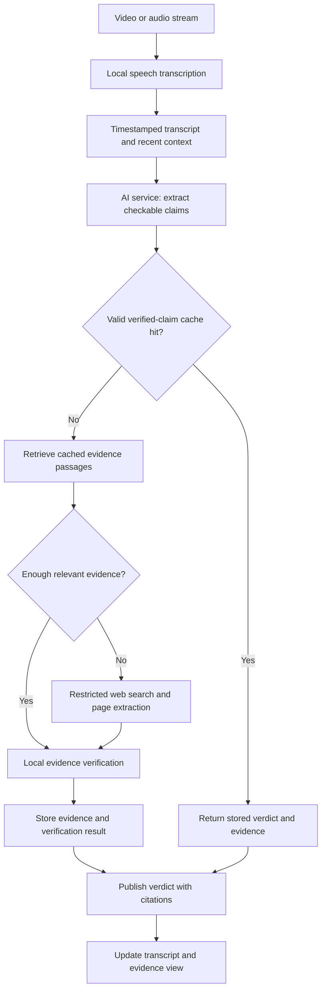

# Live Video Transcription and Fact Checking

A HES-SO 301/302 hackathon project investigating how quickly a lightweight local system can transcribe speech, identify factual claims, and check them against cited evidence.

The main research question is **how far we can reduce verification latency through model optimisation, restricted retrieval, caching, and parallel processing while preserving verification quality**. We aim for sub-second verification where feasible, particularly for claims whose verification results are already cached.

This document describes the proposed system, the division of work, and the milestones planned for 19–23 October.

## User experience

A user watches a video while its transcript appears underneath. The system checks factual claims asynchronously and highlights the relevant transcript passages. Selecting a checked passage reveals the claim, a short explanation, the evidence excerpt, and its source URL.

| State | Meaning |
| --- | --- |
| Not checked | Pending analysis, outside the supported scope, or not a checkable claim |
| Checking | Retrieval or verification is in progress |
| Supported | Retrieved evidence supports the claim |
| Contradicted | Retrieved evidence contradicts the claim |
| Uncertain | Evidence is insufficient, conflicting, or missing necessary context |

Missing evidence produces an uncertain result rather than a false verdict. The interface supports users in assessing a claim and inspecting its sources.

## Scope and constraints

- Run inference locally using pretrained models available through Hugging Face, without hosted model inference APIs.
- Start with one language and one supported video/audio input.
- Restrict web retrieval to a small, configurable source allowlist and a defined topic scope.
- Keep the application practical for the professor's laptop, with a bounded cache and modest model footprint.
- Store useful evidence passages rather than entire websites, large knowledge dumps, or permanent video recordings.

The AI baseline uses `cross-encoder/nli-MiniLM2-L6-H768`. English is the initial language. The topic scope, source allowlist, and cache size still need to be agreed. The current baseline searches the open web; restricted retrieval is planned for a later comparison.

## Development setup

The project uses Python 3.12 and `uv` for dependency management. From the repository root, create or update the environment with:

```bash
uv sync
```

In VS Code, select `.venv/bin/python` as the notebook kernel. Project dependencies are declared in `pyproject.toml`; `uv.lock` records the resolved environment used by the team.

### V1: verified-claim cache

Run `ai_agent_v1.ipynb` from the repository root in a fresh `.venv` kernel. It reuses V0's checkability/NLI decision function and the database schema, then adds exact whitespace-normalised claim lookup, expiry, verifier-version isolation, stored citations/scores/warnings, and a bounded cache. Supported/contradicted results with citations are eligible even when an unrelated page fails. Fatal search failures, uncertain results and non-checkable inputs are not cached.

The persistent experiment cache is `database/v1_claim_cache.db`; its diagnostic-column migration is automatic. All three comparison passes (uncached, V1 cold, V1 warm) share the same search/download settings, including short socket timeouts, no automatic page retries, and a cooperative page-stage budget. Search tries DuckDuckGo and falls back once to Brave. The installed DDGS engine registry is checked before searching, because disabled backend names otherwise trigger automatic provider selection. Aggregate, cited-verdict, cache-hit and cache-miss timings are reported separately; failed searches print their errors and mark the pass incomplete. The cited-verdict sub-second rate counts all factual inputs, so fast failures cannot improve it. The original unrestricted V0 notebook remains unchanged. Independent live searches can still return different results. Previous live results are retained in `benchmarks/v1_before_retrieval_fix.json`, `benchmarks/v1_after_cache_fix.json`, and `benchmarks/v1_after_search_fallback.json`.

The evidence rows in V1 are stored citations, not an evidence/RAG retrieval cache. The V1 verifier is not yet connected to the web backend.

### Claim extraction experiment

`claim_extraction.ipynb` evaluates a local model before verification. The 0.5B Qwen model produced valid JSON but remained unreliable on opinions and ambiguous references after two prompt revisions; recorded findings are kept in the notebook. The next candidate selected is Qwen2.5-1.5B-Instruct, whose quality still needs evaluation. It uses the same dependencies and functions, with roughly 6 GB of float32 weights in memory plus runtime overhead. Restart the notebook kernel before switching models.

The extractor takes stable transcript segments plus optional recent context and returns claim strings and a context-needed flag. Python attaches the supplied stable window IDs (`provenance: "input_window"`); these are broad window links, not exact source spans. The notebook includes the original examples, broader development cases, and extraction timings. It does not verify truth or use caches. The original `ai_agent.ipynb` remains the V0 verifier baseline. The first load of a new model downloads its weights; CPU inference may take several seconds or longer.

### Frontend preview

The FastAPI backend serves both the interface and the API on one port, so a single command starts the whole web app. From the repository root:

```bash
uv run fastapi dev webapp/backend/main.py
```

Wait for `Application startup complete` (Whisper loads first), then open [http://localhost:8000/](http://localhost:8000/). `fastapi dev` reloads the server when a backend file changes; after editing the frontend, refresh the page (Ctrl+F5 if the browser keeps an old `app.js`). Do not use `python -m http.server`: it serves the page but not the API, so the backend always appears disconnected.

The status in the top bar polls `GET /api/health`: grey means the backend is not running or still loading, green means the selected version is implemented, and amber means the backend is running but not that version.

The interface has five planned pipeline configurations, microphone recording, text/media input, separate transcript segments and claims, an evidence inspector, and per-version results. **Try interface demo** uses explicitly labelled fixtures, not real inference or benchmarks. See `webapp/frontend/README.md` for the integration contract.

### Backend

The backend runs the `pipeline_v0.ipynb` pipeline as the `baseline` version; other versions are rejected with HTTP 422. Every input becomes transcript segments, so typed text, microphone recordings and uploaded files then follow the same path: sentences, checkable claims, web search and NLI verification, then storage in `database/app.db` (created on startup if missing). The response is streamed: each transcript segment and claim reaches the dashboard as soon as it is ready, with claims shown as "Checking" until their verdict arrives, followed by the evidence, timings and running p50/p95 latency. The code is in `webapp/backend/`:

| File | Role |
| --- | --- |
| `main.py` | Routes only: `GET /api/health`, `POST /api/analyse/text`, `POST /api/analyse/media`, and the frontend's static files. Try them at [http://localhost:8000/docs](http://localhost:8000/docs) |
| `api_helpers.py` | HTTP helpers for the routes: version check (HTTP 422) and the streamed NDJSON response |
| `schemas.py` | Request and response shapes, matching the frontend contract |
| `versions.py` | The versions the backend implements, and which steps each enables |
| `pipeline.py` | Runs the services in order for one request; loads the models once at startup |
| `services/transcription.py` | faster-whisper in overlapping windows, for complete files/recordings and live loopback/microphone capture |
| `services/extraction.py` | v0 rule-based extraction: sentence assembly and the checkability rules |
| `services/verification.py` | v0 verifier: DuckDuckGo search, evidence passages, NLI verdict |
| `services/storage.py` | The SQLite schema from `database.ipynb` and the run/claim/verdict writes |

Services don't depend on HTTP, so notebooks can import them for benchmarks. Like v0, checking is sequential and each claim takes roughly 4–30 s, mostly web search and page downloads; the transcript also advances only between checks, so it lags behind the audio. Live capture (`transcribe_live`) is not yet exposed through an endpoint.

## Architecture



Transcription continues while verification runs. Claim IDs and video timestamps link each result to the correct transcript passage. Verification uses sufficiently stable transcript segments and recent context to resolve references, dates, numbers, and negation.

### AI service

The AI component receives text and returns whether it is checkable, a verdict, evidence references, and timings. The baseline uses simple rules to filter obvious questions, commands, and opinions, then an NLI model to compare evidence with the claim. These rules have limitations and need to be evaluated.

For now, inputs must be standalone sentences with explicit subjects. Splitting transcript segments into separate claims and resolving references such as “he” or “it” remain integration tasks. 

### Retrieval and caching

Two caches serve different purposes:

| Cache | Contents | Work it can avoid |
| --- | --- | --- |
| Verified-claim cache | Claim, verdict, evidence references, verification time, expiry, and model version | Repeating retrieval and verification for an equivalent, still-valid claim |
| Evidence cache / RAG index | Extracted passages, source URLs, dates, and embeddings | Repeating web searches, downloads, and passage processing |

Retrieval-augmented verification supplies source passages to the model. A related passage is a candidate source of evidence, not automatically a verdict.

Cache matching must preserve entities, negation, quantities, and temporal context. Semantic similarity finds candidate matches; additional checks determine whether their verdicts can be reused. Stable historical facts can have longer expiry periods than changing statistics or current officeholders.

The cache has a configurable size limit and eviction policy. Retrieval concurrency and queue growth are bounded to keep the laptop responsive.

## MVP and optimisation plan

1. **Functional baseline:** connect streaming transcription, claim extraction, retrieval, and cited verification. A terminal or structured event output is sufficient initially. Record latency without imposing a speed requirement.
2. **Minimal demonstration:** display the video/transcript and allow users to inspect evidence behind each verdict.
3. **Cache experiments:** compare fresh retrieval, cached evidence, and cached verified claims, including paraphrases and deliberately different claims.
4. **Inference optimisation:** benchmark smaller models, supported quantisation, persistent model loading, and reduced repeated inference.
5. **Pipeline optimisation:** tune audio segmentation, concurrency, duplicate-request handling, retrieval limits, and timeouts.

Establish a baseline first, then measure each optimisation against the same evaluation material.

## Weekly milestones

The schedule for 19–23 October focuses on getting the first baseline connected. The dates below are planning targets.

| Day | Date | Planned work | Expected output |
| --- | --- | --- | --- |
| Monday | 19 Oct | Define the revised scope, divide responsibilities, and agree what data the components exchange | Initial architecture and task allocation |
| Tuesday | 20 Oct | Investigate transcription, storage, and claim-verification options | Initial technical choices for each workstream |
| Wednesday | 21 Oct | Develop the three components in separate notebooks and start connecting transcription to storage | First component implementations and initial integration |
| Thursday | 22 Oct | Connect transcript input, retrieval, and cited verification and start optimisation | First complete baseline run with stage timings |
| Friday | 23 Oct | Run a small fixed set of examples and review the verdicts and citations | Terminal or notebook demonstration and first baseline measurements |

After the baseline, we will compare claim caching, evidence caching, and then inference and pipeline optimisations. Each change will be measured against the same examples. Dates for this next phase will be confirmed after the first integration run.

## Evaluation

Verification latency starts when a complete, stable claim becomes available and ends when its verdict is available for display. Separately measure caption delay and the end-to-end delay from the spoken claim's completion to the displayed verdict.

Report results separately for:

- Fresh claims requiring web retrieval.
- Claims checked against previously cached evidence.
- Valid verified-claim cache hits.
- Startup versus runs with models already loaded.

Measurements include:

- p50 and p95 latency, and the proportion of checks completed within one second.
- Throughput and cache-hit rate.
- Claim-detection and verification quality.
- Citation correctness and the proportion of claims receiving uncertain verdicts.
- Memory consumption and disk footprint.

The evaluation set should contain supported and contradicted claims, opinions, ambiguous statements, paraphrases, negations, and changed dates or quantities. Recorded speech replayed at normal speed provides a repeatable streaming benchmark. Document preloaded evidence and cache contents to distinguish repeated-claim performance from unseen-claim performance.

## Team organisation

| Workstream | Responsibilities | Assignee |
| --- | --- | --- |
| Audio and transcription | Video/audio ingestion, local speech model, timestamps, transcript stability, and transcription latency | Ünal |
| Storage and parallel processing | Database, caches, retrieval, indexing, queues, concurrency, and retrieval measurements | Alexis |
| AI and verification | Claim detection, context resolution, embeddings, evidence assessment, model selection, and quality evaluation | Youssef |

Each team member develops their component in a separate notebook. The next integration step is to agree the transcript and claim fields passed between components, including identifiers and timestamps. Integration, the demonstration, and final benchmarks are shared responsibilities.
Following the initial project files, we will collaborate on connecting the feature sets together and how and where to expand after analysis of each others codes and program capabilities.


## Course contribution

- **301:** compare local neural models and inference configurations, evaluate claim detection and evidence verification, and measure the quality/latency trade-off.
- **302:** process a continuous stream using bounded queues, parallel retrieval, indexing, cache policies, provenance tracking, and resource-aware execution.

The deliverable is a reproducible optimisation study supported by a working demonstration. Sub-second performance on every new claim remains a target to investigate.
